<div align="center">

# 📶 Hostel WiFi Auto-Login

**Join the hostel Wi-Fi. Get online. That's it.**

Signs you in to the VIT hostel Wi-Fi captive portal (**any block**: Q-VIT, G-VIT, VIT-Hostel and friends) the moment you connect, so you never open a browser and type your password again.


</div>

---

## 🚀 Set it up in 1 minute

No coding. No commands. Just follow the pictures.

### Step 1: Download

Click the green **`<> Code`** button at the top of this page, then **Download ZIP**.

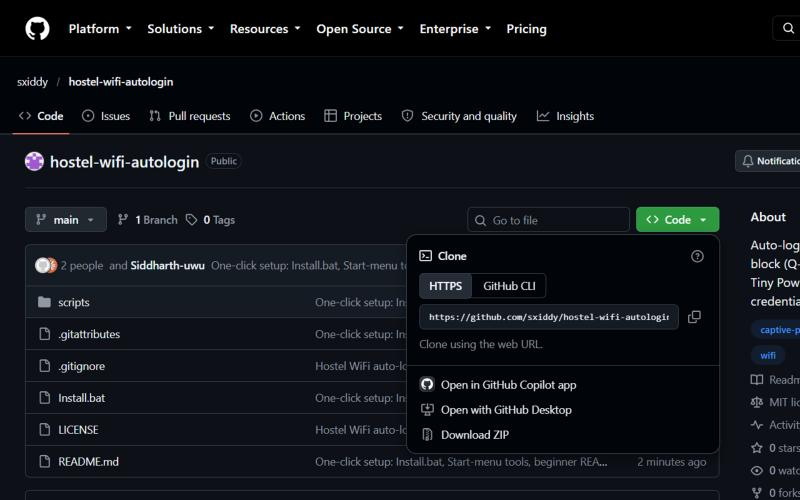

### Step 2: Extract

Open your **Downloads** folder. You'll see `hostel-wifi-autologin-main`.

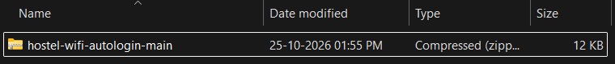

**Right-click it → Extract All → Extract.** A new folder opens with `Install` inside:

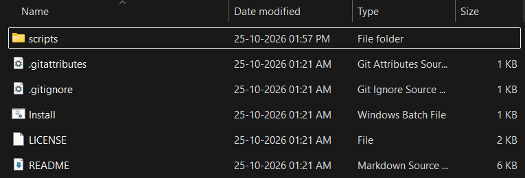

> ⚠️ **Don't skip extracting.** Opening `Install` from *inside* the ZIP won't work.

### Step 3: Double-click `Install`

A black setup window opens. Type your **username** (usually your registration number) and press **Enter**.

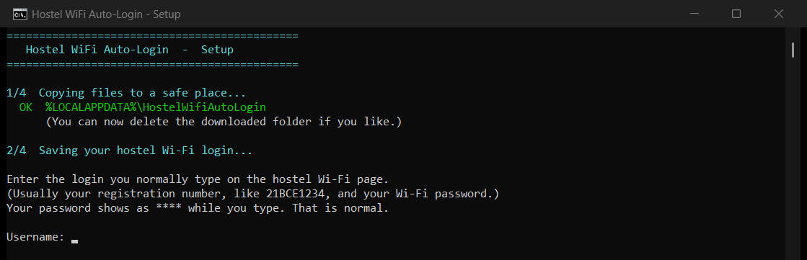

Type your **password**, press **Enter**, then type it **once more** and press **Enter**. It shows as `****` while you type. That's normal.

Check the username it shows you. If it's right, type **Y** and press **Enter**. If not, type **N** to start again.

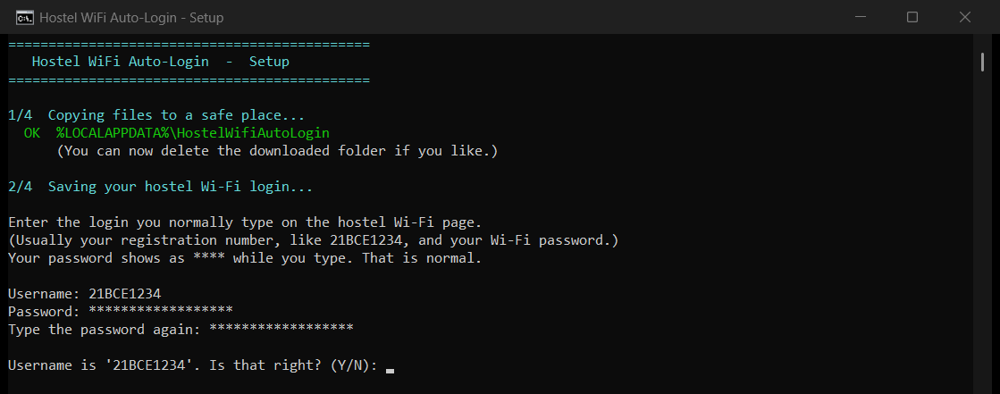

Wait for **"All done!"**, then press any key to close the window.

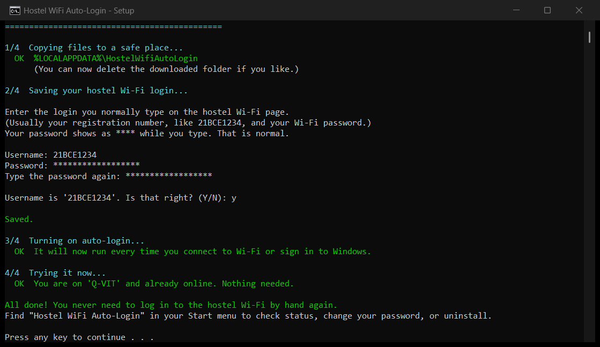

That's it. From now on, whenever you connect to the hostel Wi-Fi or start your laptop, you're signed in automatically.

<details>
<summary><b>Windows says "Windows protected your PC"?</b></summary>

This appears for any script you download from the internet. Click **More info → Run anyway**. The whole tool is a few short, readable files in this repo, so you can check exactly what it does first.

</details>

## 🛠 Managing it

Open the **Start menu** and search for **Hostel WiFi Auto-Login**. You'll find three shortcuts:

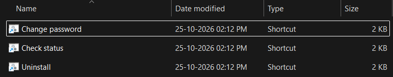

| Shortcut | What it does |
| --- | --- |
| **Check status** | Shows if it's installed, which login is saved, your network, and whether the internet works |
| **Change password** | Saves a new username or password |
| **Uninstall** | Turns it off and deletes your saved login from this PC |

**Check status** looks like this when everything is fine:

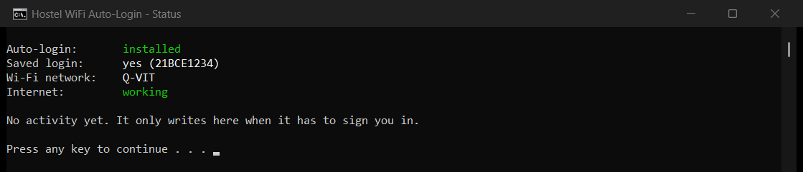

You can delete the downloaded folder after installing. Everything it needs has been copied to a safe place.

## 🔑 Typed something wrong? Changed your password?

### While setting up

Setup catches typos before saving anything:

- **Password typo:** you type it twice. If the two don't match, it asks again.
- **Username typo:** it shows you the username and asks *"Is that right?"*. Type **N** to re-enter everything.

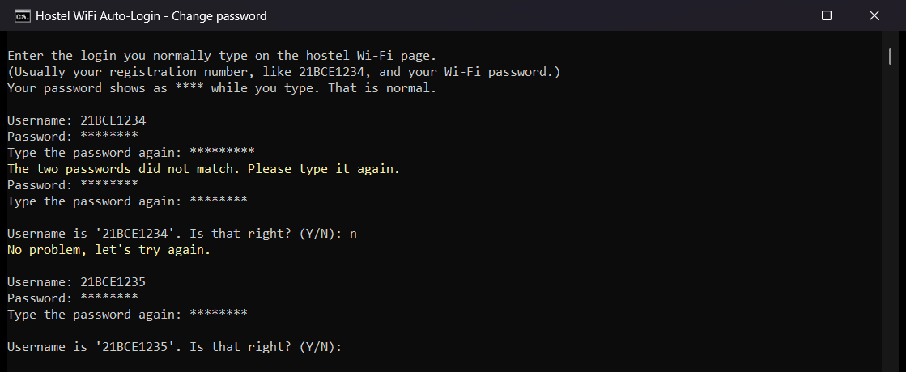

### Saved the wrong password anyway

The next time it tries to sign you in, the portal rejects it. The script will then:

1. **Stop trying** that login, so your account doesn't get locked for too many wrong attempts.
2. **Show a Windows notification**: *"Hostel Wi-Fi: wrong username or password"*.
3. Show it in red in **Check status**:

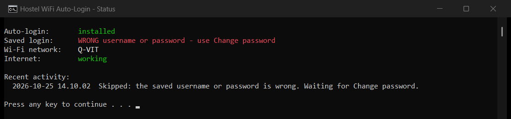

**To fix it:** Start menu → **Hostel WiFi Auto-Login** → **Change password**, then type the correct login. Reconnect to the Wi-Fi and you're in.

### Changed your password on the VIT Wi-Fi website

Do the same thing: Start menu → **Hostel WiFi Auto-Login** → **Change password**, and type your new password.

If you forget, nothing breaks. The next time you connect, you'll get the "wrong username or password" notification reminding you.

## ✨ Why you'll like it

- **Zero clicks.** Runs on every Wi-Fi connect and every Windows sign-in.
- **Works in every block.** All VIT networks share one portal and one login, so one script covers them. It acts on any network with "VIT" in its name and ignores everything else (home, cafe, phone hotspot).
- **Checks first.** If you already have internet, it does nothing.
- **Retries.** Six attempts, five seconds apart, in case the portal is slow to wake up.
- **Protects your account.** If your login is rejected, it stops instead of hammering the portal.
- **Your password stays yours.** It's encrypted with Windows' own protection and can only be read by your Windows account on your PC. It never leaves your laptop.
- **Nothing extra to install.** Uses only what's already in Windows.

## ❓ Troubleshooting

| What you see | What to do |
| --- | --- |
| Not signing in at all | Open **Check status**. It tells you what's wrong. |
| "wrong username or password" notification | Use **Change password**. |
| "Too many devices are logged in" notification | Log out on another device (phone, other laptop), then reconnect. |
| "could not resolve phc.prontonetworks.com" in the log | The Wi-Fi portal wasn't ready yet. Disconnect and reconnect. |
| Want to start over | Run **Uninstall**, then double-click `Install` again. |

Still stuck? [Open an issue](../../issues) and paste what **Check status** shows. Never paste your password.

## 🗑 Uninstalling

Start menu → **Hostel WiFi Auto-Login** → **Uninstall**. It turns auto-login off and deletes your saved login.

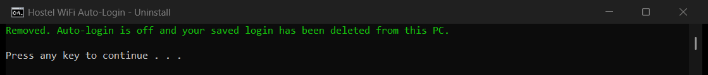

## 🧠 How it works

```
Wi-Fi connects  ──┐
                  ├──▶  wifi_login.ps1
You sign in to ───┘          │
Windows                      ▼
                  VIT network? ─no─▶ stop
                             │ yes
                             ▼
                  Already online? ─yes─▶ stop
                             │ no
                             ▼
        Send your saved login to the Pronto portal (up to 6 tries)
                             │
              ┌──────────────┼──────────────────┐
              ▼              ▼                  ▼
          Logged in     Wrong login        Too many devices
                        → stop + notify    → notify
```

`Install` copies the scripts to `%LOCALAPPDATA%\HostelWifiAutoLogin`, saves your login there, and creates a Windows Scheduled Task that runs `wifi_login.ps1` at logon and whenever the WLAN service reports a new connection.

<details>
<summary><b>What's in the repo</b></summary>

| File | Purpose |
| --- | --- |
| `Install.bat` | The only thing you need to double-click |
| `scripts/install.ps1` | Does the install: copies files, saves login, creates the task |
| `scripts/wifi_login.ps1` | The auto-login logic |
| `scripts/setup.ps1` | Asks for your login (with typo checks) and encrypts it into `cred.xml` |
| `scripts/status.ps1` | Powers **Check status** |
| `scripts/uninstall.ps1` | Powers **Uninstall** |
| `scripts/*.bat` | Start-menu launchers for the scripts above |
| `docs/images/` | The screenshots in this README |

`cred.xml`, `log.txt` and `badlogin.flag` are created on your PC only and are git-ignored.

</details>

## 🔒 Security notes

- Your login is encrypted with the Windows Data Protection API. It can't be read on another PC or by another Windows user.
- The hostel portal only offers plain HTTP, so only use this on the hostel network.
- Never share or upload `cred.xml`.

## 🗺 Roadmap

- [ ] A tray app with a status light and a "log in now" button
- [ ] Multi-campus support (other campuses may use different portals)
- [ ] Linux and macOS versions

## 🤝 Contributing

Issues and pull requests are welcome. If your hostel uses a different portal, open an issue with the login URL and form field names.

Want a full app with a GUI and Android support? Check out [Latch by VinnovateIT](https://github.com/vinnovateit/latch). This project is the tiny, no-frills alternative.

## 📄 License

[MIT](LICENSE) © Siddharth D
